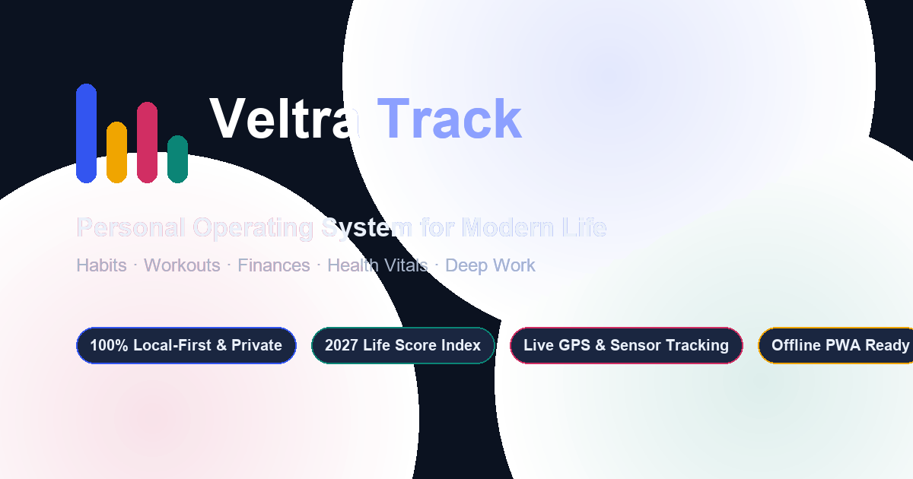

# Veltra Track — Personal Operating System

 

**A private, distraction-free personal operating system for mastering your daily habits, athletic workouts, financial health, recovery vitals, and deep focus.**

### 👉 [Open Veltra Track App](https://veltratrack.vercel.app/)

 

---

## 🌟 Why Veltra Track?

Most productivity and health apps require multiple subscriptions, force cloud sign-ins, sell your telemetry, and clutter your routine across separate tools.

**Veltra Track** brings everything together into a single, cohesive operating system designed for human focus:

- **Zero Sign-Up Required**: Open the link and immediately start tracking.
- **100% Private & Local**: Your logs, finances, and journal notes never leave your personal device.
- **Works Everywhere**: Runs smoothly in any browser on iPhone, Android, Mac, or Windows, and operates completely offline.

---

## 🧭 Your Daily Experience

### 🌅 1. Today Dashboard & Veltra Pulse AI
Start every morning with clarity:
- **Daily Briefing**: Contextual AI-style digest summarizing your sleep recovery, pending habits, movement goals, and remaining daily allowance.
- **2027 Life Score Index (0–100)**: A composite daily wellness balance calculated across your habits (30 pts), movement (25 pts), sleep recovery (20 pts), hydration (15 pts), and screen time (10 pts).
- **Day Selector & History**: Easily step backward to reflect on previous days or plan upcoming targets.

### 🎯 2. Habits & Consistency Heatmap
Build momentum that lasts:
- **20-Week Consistency Heatmap**: A visual GitHub-style grid showing your daily execution density over the past 5 months.
- **Streak Records**: Live celebration of current streaks, all-time best streaks, and 30-day consistency ratios.
- **Flexible Schedules**: Set habits for every day, workdays only, weekends, or specific custom days.

### 🏃 3. Move & Athletic Workouts
Track every session effortlessly:
- **Live Outdoor Tracking**: Tap **Start Run** or **Start Walk** to track pace, distance, and duration in real time with GPS.
- **Automatic Step Counter**: Uses your phone's built-in motion sensor to count steps and generate route polylines.
- **Keep-Awake Engine**: Prevents your screen from going dark while you're exercising.
- **Strength Training Log**: Record sets, reps, and weights with automated Personal Best tracking.

### 💳 4. Money & Expense Ledger
Stay in total control of your cash flow:
- **Monthly Pacing & Budgets**: Set your monthly spending cap and see your exact daily pacing in real time.
- **Interactive Daily Spend Graph**: Interactive bar charts highlighting spending velocity and high-expense days.
- **Category Budgets**: Manage limits for Groceries, Dining, Transport, Bills, Shopping, and Health.
- **Global Currencies**: Formats instantly in INR (`₹`), USD (`$`), EUR (`€`), GBP (`£`), JPY (`¥`), and more.

### 💧 5. Health & Vitals
Optimize physical and mental recovery:
- **Hydration Tracker**: 1-tap logging with customizable targets (litres or ounces).
- **Daily Step Counter**: Track progress against your daily step goal with a 14-day trendline.
- **Sleep & Rest**: Log hours of sleep and subjective quality ratings to monitor recovery patterns.
- **Digital Wellbeing**: Monitor total phone screen time, pickup counts, and app-by-app breakdowns.

### ⏱️ 6. Focus & Flow State Engine
Protect your deep cognitive energy:
- **Flow State Timers**: Instant presets for 25m Pomodoro, 50m Deep Work, 90m Flow State, and 5m Reset blocks.
- **Harmonic Chimes**: Calming bell chimes synthesized directly in your browser using procedural audio oscillators.
- **Session Journal**: Save completed deep work intervals directly into your daily journal notes.

### ⚡ 7. Command Palette (`Ctrl + K` / `⌘K`)
Navigate at the speed of thought:
- Press `Ctrl+K` (or tap **Search**) to instantly search actions, jump between tabs, log water, start a workout, or toggle dark/light theme without touching your mouse.

---

## 📲 Install as an App (Use Offline Anywhere)

You can use Veltra Track just like a native app on your phone or computer:

- **On iPhone / iPad (Safari)**:
  1. Open [veltratrack.vercel.app](https://veltratrack.vercel.app/).
  2. Tap the **Share** button (`⎋`).
  3. Select **Add to Home Screen** (`⊕`).
- **On Android / Chrome / Edge**:
  1. Open [veltratrack.vercel.app](https://veltratrack.vercel.app/).
  2. Tap the **Download App** button in the top bar (or the install prompt in your browser address bar).
- **Offline HTML Download**:
  - Click **Download App** → **Download Standalone HTML** to save a permanent, self-contained single-file version directly to your computer.

---

## 🔒 100% Private & Local-First

- **No Remote Databases**: Your habits, financial figures, workout history, and personal notes are stored strictly in your browser's private local storage.
- **No Trackers**: Zero third-party trackers, cookies, or analytics scripts.
- **Total Data Sovereignty**: Back up your data anytime in **Settings → Backup (JSON)**, or export clean CSV spreadsheets for Excel and Google Sheets.

---

## ⌨️ Quick Keyboard Shortcuts

| Shortcut | Action |
| :--- | :--- |
| `Ctrl + K` or `⌘ + K` | Open Command Palette |
| `Escape` | Close any sheet, dialog, or search |
| `Arrow Up` / `Down` | Browse command list |
| `Enter` | Select and execute command |

---

## 📄 License

Distributed under the [MIT License](LICENSE). Copyright &copy; 2026 Teja Priyan.
